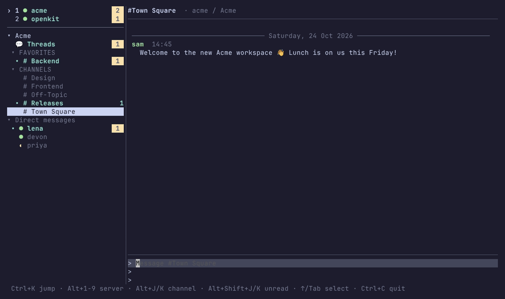

# termost

A lightweight terminal client for [Mattermost](https://mattermost.com).



## Quick start

```sh
curl -fsSL https://github.com/kurund/termost/releases/latest/download/termost_linux_$(uname -m).tar.gz | tar xz termost
mkdir -p ~/.local/bin && mv termost ~/.local/bin/

mkdir -p ~/.config/termost
cat > ~/.config/termost/config.toml <<'EOF'
[[server]]
name = "work"
url = "https://chat.example.com"
username = "your-username"
EOF

termost
```

This assumes `~/.local/bin` is on your `PATH`. termost asks for your password on first launch. See [Installing](#installing) for other options and [Configuration](#configuration) for the full config.

## Features

- **Several servers in one window**, one shown at a time, with connection state and unread badges for the others
- **Your Mattermost sidebar**: teams, Favorites and custom categories (with their sorting and collapsed state), DMs with online/away/DND status, closed DMs hidden as in the web app
- **Unread and mention tracking** that matches the official clients, including Collapsed Reply Threads
- **Threads**: reply counts, a thread view, replying, and a followed-threads list per team (`Alt+T`)
- **Reactions**: shown under messages with who reacted on the selected one, `+:emoji:` shortcut, an emoji picker and click to toggle
- **Markdown** rendered for the terminal: code blocks, lists, quotes, tables, clickable links, emoji shortcodes, highlighted mentions
- **Files**: upload from disk (or drag files onto the terminal) or the clipboard, open attachments with your default app (`o` on a message, or click the file)
- **Desktop notifications** following your Mattermost notification settings, collapsed per channel
- **Quick switcher** (`Ctrl+K`) with fuzzy search, plus `@user`, `~channel` and `:emoji:` completion
- **Message search** (`Ctrl+F` or `/search`) across all teams on a server, with Mattermost's search syntax
- **Mouse**: click channels, messages and links, double-click for threads, scroll with the wheel
- Reconnects automatically and catches up on missed messages; asks for your password in place when a session expires

## Footprint

One process, one static binary. Measured side by side with the official desktop app on the same machine, connected to the same two servers:

| | termost | Mattermost Desktop 6.3 (Electron) |
|---|---|---|
| Memory (PSS) | 35-60 MB | about 1.3 GB |
| CPU while idle | about 1% of one core | about 20% of one core |
| Processes / threads | 1 / 15 | 19 / 259 |
| Install size | 23 MB | 1.4 GB including Electron |

Numbers vary with server size and how many channels you have open.

## Requirements

- Linux (desktop notifications use D-Bus; the clipboard uses `wl-clipboard` or `xclip`, with OSC 52 as a fallback for copying)
- A Mattermost server over https where you log in with a username and password (SSO, MFA and personal access tokens are not supported yet). Plain http is only accepted for `localhost`
- To build from source: Go 1.26 or newer, or Nix

## Installing

Prebuilt binaries for x86_64 and arm64 are on the [releases page](https://github.com/kurund/termost/releases). Download the latest one for your machine and copy `termost` anywhere on your `PATH`:

```sh
curl -fsSL https://github.com/kurund/termost/releases/latest/download/termost_linux_$(uname -m).tar.gz | tar xz termost
mkdir -p ~/.local/bin && mv termost ~/.local/bin/
```

Each archive also contains `config.example.toml`, the README and the license. `checksums.txt` on the release page has SHA-256 sums.

With Nix, run it without installing, or add it to your profile:

```sh
nix run github:kurund/termost
nix profile install github:kurund/termost
```

On NixOS, add the flake as an input and use `inputs.termost.packages.${pkgs.stdenv.hostPlatform.system}.default`.

Or install with Go 1.26+:

```sh
go install github.com/kurund/termost/cmd/termost@latest
```

To build from a clone, see [Development](#development).

## Configuration

termost reads `~/.config/termost/config.toml`. `config.example.toml` (in the release archive and the repo) has every option:

```toml
[[server]]
name = "work"                       # shown in the sidebar, used on the command line
url = "https://chat.example.com"
username = "your-username"

[[server]]
name = "community"
url = "https://community.mattermost.com"
username = "your-username"

[notifications]
desktop = true   # freedesktop notifications over D-Bus
bell = false     # terminal bell
osc = false      # OSC 777 notifications (foot, WezTerm, Ghostty)

[ui]
dm_limit = 30    # most recent DMs to list; unread ones always show. 0 = all
mouse = true     # click and scroll; hold Shift to select text with the mouse
```

Your password is never stored. termost keeps only the session token, in the Secret Service keyring (gnome-keyring, KWallet). If no keyring is running it falls back to `~/.local/state/termost/tokens.json` with `0600` permissions.

## Usage

```sh
termost              # open the chat UI (asks for passwords for servers that need one)
termost login [server...]
termost logout [server...]
termost channels     # list teams, channels and DMs with unread counts
termost tail         # print new messages from all servers as they arrive
termost notify-test  # send a test desktop notification
termost version
```

Commands act on all configured servers unless you name some.

## Keys

### Everywhere

| Key | Action |
|---|---|
| `Ctrl+K` | Jump to a channel or DM on the current server |
| `Alt+T` | Open or close the followed threads list for the current team (also in `Ctrl+K` as "Threads") |
| `Ctrl+F` | Search messages on the current server (`↑`/`↓` and `Enter` open a result in its thread, `Esc` goes back) |
| `Alt+1` … `Alt+9` | Switch server |
| `Alt+J` / `Alt+K` | Next / previous channel |
| `Alt+Shift+J` / `Alt+Shift+K` | Next / previous unread channel |
| `Tab` / `Shift+Tab` | Cycle focus: message box, messages, sidebar |
| `PgUp` / `PgDn` | Scroll messages (older history loads at the top) |
| `Ctrl+L` | Log in again after dismissing an expired-session prompt |
| `Ctrl+C` / `Ctrl+Q` | Quit |

### Message box

| Key | Action |
|---|---|
| `Enter` | Send |
| `Shift+Enter` | New line (terminals that report it, e.g. kitty, foot, WezTerm, Ghostty) |
| `Alt+Enter` / `Ctrl+J` | New line (works in every terminal) |
| `↑` (when empty) | Select messages |
| `@`, `~`, `:` | Complete users, channels and emoji (`:` after 2 letters, e.g. `:thu`; `Tab`/`Enter` accepts, `Esc` dismisses) |
| `Esc` | Close the open thread |

### Selected messages

The selected message lists who reacted, e.g. `👍 alice, bob, you`.

| Key | Action |
|---|---|
| `j` / `k`, `↓` / `↑` | Next / previous message |
| `g` / `G` | First / last message |
| `Enter` / `r` | Open the thread to read or reply |
| `+` | React with an emoji |
| `y` | Copy the message text (as markdown) |
| `Y` | Copy a link to the message |
| `e` | Edit your message (`Enter` saves, `Esc` cancels and restores your draft) |
| `d` | Delete your message (asks `y`/`n`) |
| `o` | Open the message's attachments |
| `Esc` / `i` | Back to the message box |

### Sidebar

| Key | Action |
|---|---|
| `j` / `k`, `↓` / `↑` | Move |
| `Enter`, `Space`, `h`/`l`, `←`/`→` | Open a channel, collapse or expand a group, switch server |
| `Esc` | Back to the message box |

Below 70 columns the sidebar hides; `Tab` shows it full screen.

### Mouse

| Action | Result |
|---|---|
| Click a channel, group or server | Open it, collapse or expand it, switch server |
| Click a message | Select it (then use the keys above) |
| Click a reaction | Add or remove your own reaction with that emoji |
| Double-click a message | Open its thread |
| Click a link | Open it in your browser |
| Click an attachment | Download it and open it with your default app |
| Click a suggestion or switcher entry | Pick it |
| Scroll wheel | Scroll messages (older history loads at the top), the sidebar or a list |

termost captures the mouse, so hold `Shift` while dragging to select text with your terminal. Set `mouse = false` under `[ui]` to turn it off.

## Commands in the message box

| Command | Action |
|---|---|
| `+:emoji:` | Toggle a reaction on the newest message |
| `/upload <path>...` | Upload up to 10 files in one message (`Tab` completes the path, `~` works) |
| `/paste` | Upload the image on the clipboard |
| `/search <terms>` | Search messages on the current server; supports `from:user`, `in:channel`, `"phrases"`, `-exclude`, `before:`/`after:`/`on:YYYY-MM-DD` and `word*` |
| `//text` | Send a message that starts with `/` |
| any other `/command` | Run it on the server, e.g. `/away`, `/online` |

Put `/paste` or `/upload <path>` at the end of a message to send the text and the file together, e.g. `Hi, please check this /paste`. Dragging files onto the message box adds the `/upload` for you; press `Enter` to send. Uploads and reactions go to the open thread when there is one.

## Terminal and tmux tips

- **Notifications for the open channel** depend on the terminal reporting focus. In tmux add `set -g focus-events on`.
- **Clickable links** use OSC 8 hyperlinks. With the mouse on, a click opens them; with `mouse = false` the terminal handles them, with a click or `Ctrl+click` depending on the terminal (Ghostty on Linux needs `Ctrl`). In tmux 3.4+ add `set -as terminal-features ",*:hyperlinks"`.
- **Shift+Enter** needs a terminal that reports modified keys. In tmux add `set -g extended-keys on` and `set -g extended-keys-format csi-u`; otherwise use `Alt+Enter`.
- Emoji and wide characters need a font with emoji support.

## Troubleshooting

- Logs go to `~/.local/state/termost/termost.log`, never to the screen.
- `termost notify-test` checks that desktop notifications reach your notification daemon. Your own messages never notify.
- Downloaded attachments are cached in `~/.cache/termost/files`.

## Development

The Nix flake provides Go, gopls, golangci-lint and GoReleaser. Without Nix, install Go 1.26+.

```sh
nix develop
go build -o bin/termost ./cmd/termost
go test ./...
golangci-lint run ./...
```

For a local test server:

```sh
docker run -d --name termost-mm -p 8065:8065 mattermost/mattermost-preview
```

Then point a `[[server]]` entry at `http://localhost:8065`. The first account you create on it becomes the system admin. `nix develop .#demo -c demo/record.sh` re-records the demo GIF against it.

Pushing a `v*` tag (e.g. `v0.2.0`) builds the release binaries and publishes them on GitHub.

Code layout:

```
cmd/termost        CLI entry point
internal/config    config file
internal/auth      session token storage
internal/mm        per-server REST and websocket session
internal/store     per-server state: channels, unread counts, posts, categories
internal/ui        Bubble Tea interface
internal/markdown  chat-oriented markdown renderer
internal/notify    notification rules and backends
internal/emoji     emoji names to Unicode
internal/clip      clipboard images
demo               seed data and VHS tape for the README GIF
```

## License

termost is free software: you can redistribute it and/or modify it under the terms of the [GNU Affero General Public License](LICENSE) as published by the Free Software Foundation, either version 3 of the License, or (at your option) any later version (`AGPL-3.0-or-later`).
